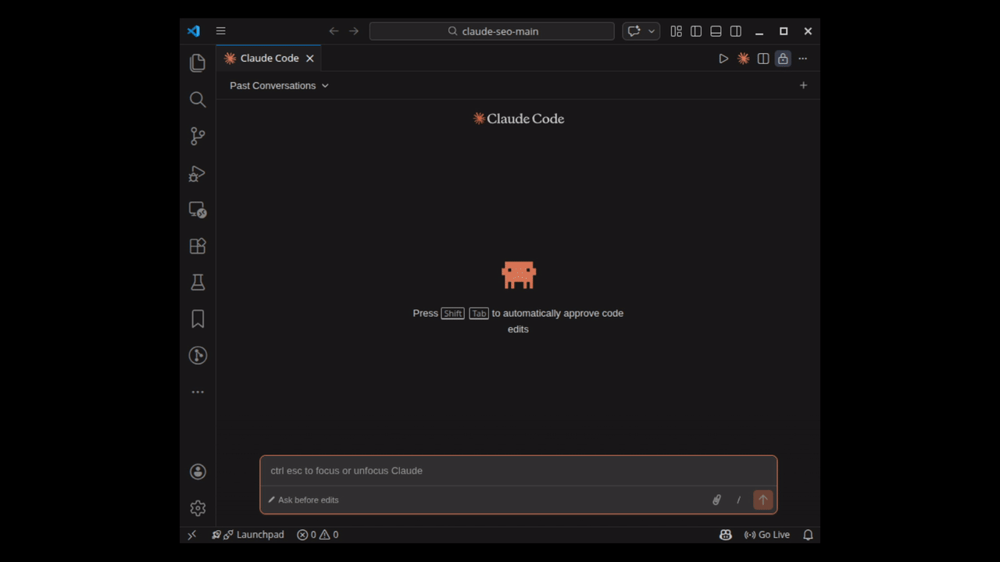
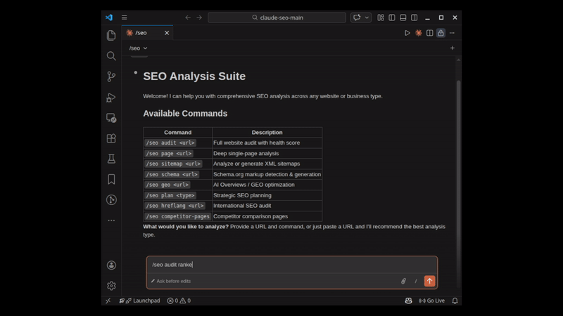

<!--
  Antigravity SEO (antigravity-seo): free, open-source SEO, GEO, AEO & Technical Audit skill for Google Antigravity.
  Technical SEO, Core Web Vitals, E-E-A-T, Schema.org, AI search (GEO), local SEO, e-commerce, and international SEO.
  26 sub-skills and 19 specialist agents. MIT licensed.
-->



<h1 align="center">Antigravity SEO</h1>

<p align="center">
  <b>Free, open-source SEO audits and optimization framework for <a href="https://github.com/IshtiakNihal/Antigravity-SEO">Google Antigravity</a>.</b><br />
  Rank higher in Google Search and get cited by AI engines (ChatGPT, Perplexity, Gemini, Copilot).
</p>

<p align="center">
  <a href="#install">Install</a> ·
  <a href="#see-it-in-action">Demo</a> ·
  <a href="#real-results">Results</a> ·
  <a href="#meet-the-team">Team</a> ·
  <a href="#commands">Commands</a> ·
  <a href="#pricing">Comparison</a> ·
  <a href="#faq">FAQ</a>
</p>

<p align="center">
  <a href="https://github.com/IshtiakNihal/Antigravity-SEO/actions/workflows/ci.yml"></a>
  
  <a href="LICENSE"></a>
  <a href="tests/"></a>
  <a href="SECURITY.md"></a>
  <a href="PRIVACY.md"></a>
</p>

---

## What is Antigravity SEO?

**Antigravity SEO** is a complete, modular, battle-tested SEO framework designed specifically for **Google Antigravity** (and compatible with Cursor, Claude Code, and Codex agent systems). 

Give it any website or URL and it runs a full multi-agent SEO audit in minutes, then hands you a prioritized action plan sorted by what matters most.

It covers everything modern search engines and AI answer engines demand:

- **Technical SEO:** Crawlability, indexing, sitemaps, robots.txt, canonical loops, redirect chains, and Core Web Vitals (LCP, INP, CLS).
- **Content Quality & E-E-A-T:** Experience, expertise, authority, and trust. Evaluates depth, reading levels, and purges robotic AI fluff.
- **Structured Data:** Detects, validates, and writes Schema.org JSON-LD markup (`Product`, `Article`, `Organization`, `LocalBusiness`, `FAQPage`).
- **AI Search (GEO):** Evaluates how likely **Google AI Overviews**, **ChatGPT Search**, **Perplexity**, **Gemini**, and **Copilot** are to cite your pages.
- **Answer Engine Optimization (AEO):** Implements the high-intent 10-FAQ formula with upfront 1–2 sentence direct factual answers.
- **E-Commerce & SaaS:** Catalog integrity, unique SKU management, multi-currency support, conversion trust badges, and feature comparison matrices.
- **Local & Maps SEO:** Google Business Profile audits, map pack visibility, local citations, and NAP consistency.

Antigravity SEO is built from **26 sub-skills** and **19 specialist agents**. Up to 17 agents work on your site in parallel, providing reproducible evidence for every single fix.

---

## See it in Action

Type `/seo` in Antigravity to see available workflows:



Run a full audit and watch the agents fan out across your website:



---

## Real Results

Audited and optimized with the Antigravity SEO methodology: 10.8K Google Search Console clicks in the first 12 weeks, high AI search citability across Gemini & Perplexity, and a 99 mobile PageSpeed score.


---

## Meet the Team



<details>
<summary><b>View All 19 Specialist Agents</b></summary>
<br />

| Agent | Role | Focus | Primary Command |
|---|---|---|---|
| `seo-technical` | Technical SEO Lead | Crawl, indexing, status codes, canonicals | `/seo technical <url>` |
| `seo-content` | Content & E-E-A-T Editor | Topic depth, information gain, anti-AI tone | `/seo content <url>` |
| `seo-schema` | Structured Data Engineer | Schema.org JSON-LD generation & validation | `/seo schema <url>` |
| `seo-geo` | AI Search Analyst | AI Overviews, citability, entity density | `/seo geo <url>` |
| `seo-aeo` | Answer Engine Architect | 10-FAQ formula with upfront direct answers | `/seo aeo <topic>` |
| `seo-sitemap` | Sitemap Architect | XML sitemap discovery, partition health | `/seo sitemap <url>` |
| `seo-performance` | Performance Engineer | Core Web Vitals, script blocking, LCP/INP | `/seo audit <url>` |
| `seo-ecommerce` | Commerce Specialist | Catalog integrity, unique SKUs, product schema | `/seo ecommerce <url>` |
| `seo-local` | Local SEO Specialist | Google Business Profile, local citations | `/seo local <url>` |
| `seo-maps` | Maps Intelligence Analyst | Geo-grid ranking, map pack visibility | `/seo maps <query>` |
| `seo-google` | Google API Analyst | Search Console, CrUX, PageSpeed, Indexing API | `/seo google [cmd]` |
| `seo-backlinks` | Link Analyst | Backlink profiles, Common Crawl, Moz, Bing | `/seo backlinks <url>` |
| `seo-cluster` | Topic Strategist | Semantic clustering, pillar-cluster linking | `/seo cluster <keyword>` |
| `seo-competitor` | Competitive Analyst | Competitor comparison pages, feature matrices | `/seo competitor-pages` |
| `seo-sxo` | Search Experience Designer | Intent alignment, UX conversion, persona flow | `/seo sxo <url>` |
| `seo-drift` | Change Monitor | SQLite snapshot baselines, ranking drift | `/seo drift <cmd>` |
| `seo-agentic` | Agent Readiness Analyst | llms.txt, WebMCP, accessibility tree | `/seo agentic <url>` |
| `seo-programmatic` | Programmatic Architect | Scalable URL patterns, database templates | `/seo programmatic` |
| `seo-hreflang` | International SEO | Multi-language tags, regional routing | `/seo hreflang <url>` |

</details>

---

## Commands



Antigravity SEO includes 30 commands grouped into six operational categories:

<details>
<summary><b>1. Audits & Planning (5 commands)</b></summary>

* `/seo audit <url>`: Full website multi-agent parallel audit.
* `/seo page <url>`: Deep single-page technical and content analysis.
* `/seo plan <business-type>`: Strategic SEO planning (saas, local, ecommerce, publisher, agency).
* `/seo doctor`: Check environment and tool readiness.
* `/seo setup`: Refresh Python runtime dependencies and browser binaries.
</details>

<details>
<summary><b>2. Technical SEO & Performance (7 commands)</b></summary>

* `/seo technical <url>`: Comprehensive crawlability, indexing, and heading audit.
* `/seo sitemap <url>`: XML sitemap discovery, partition validation, and lastmod health.
* `/seo images <url>`: Image optimization, WebP/AVIF format, and alt-text checks.
* `/seo hreflang <url>`: International SEO and language targeting validation.
* `/seo programmatic <plan>`: Scalable programmatic architecture and URL blueprints.
* `/seo google [command]`: Search Console, PageSpeed, CrUX, and Indexing API queries.
* `/seo drift baseline | compare <url>`: Track ranking and content changes with SQLite baselines.
</details>

<details>
<summary><b>3. Content, E-E-A-T & Humanizer (6 commands)</b></summary>

* `/seo content <url>`: E-E-A-T and content quality scoring.
* `/seo content-brief <topic>`: Generate comprehensive content briefs with keywords and outlines.
* `/seo cluster <keyword>`: SERP-based semantic topic clustering.
* `/seo sxo <url>`: Search Experience Optimization for user stories and intent.
* `/seo competitor-pages <url>`: Competitor comparison page matrix generation.
* `/seo humanize <text>`: Purge robotic AI clichés and enhance factual information gain.
</details>

<details>
<summary><b>4. Schema & AI Search / GEO (3 commands)</b></summary>

* `/seo schema <url>`: Detect, validate, and generate Schema.org JSON-LD.
* `/seo geo <url>`: Generative Engine Optimization for ChatGPT, Perplexity, Gemini, and Copilot.
* `/seo aeo <topic>`: Answer Engine Optimization with the 10-FAQ formula for AI Overviews.
</details>

<details>
<summary><b>5. Local, Commerce & Links (4 commands)</b></summary>

* `/seo ecommerce <url>`: E-commerce catalog integrity, pricing, SKU, and schema audit.
* `/seo local <url>`: Local SEO, Google Business Profile, and NAP verification.
* `/seo maps <query>`: Local pack and geo-grid visibility intelligence.
* `/seo backlinks <url>`: Domain backlink profile analysis.
</details>

<details>
<summary><b>6. Agentic & Future-Proofing (5 commands)</b></summary>

* `/seo agentic <url>`: AI agent readiness (`llms.txt`, WebMCP, markdown accessibility).
* `/seo flow [stage]`: Evidence-based FLOW methodology prompts.
* `/seo titles <keywords>`: High-CTR title tag and meta description engineering.
* `/seo bing [command]`: Bing Webmaster Tools & IndexNow instant submissions.
* `/seo unlighthouse <url>`: Multi-page batch Lighthouse audits.
</details>

---

## Comparison: Why Antigravity SEO?



| Feature | Manual Consulting | Traditional Agency | Legacy SaaS Tools | **Antigravity SEO** |
|---|---|---|---|---|
| **Audit Duration** | 4 to 8 hours | 2 to 4 weeks | 15 to 45 minutes | **5 to 10 minutes** |
| **Cost** | Hourly billing | $3,000–$15,000 / mo | $99–$999 / mo | **100% Free & Open-Source** |
| **AI Search (GEO/AEO)** | Rare | Often outdated | Behind curve | **Native AI Overview & LLM Citations** |
| **Data Privacy** | Manual | Shared with vendor | Uploaded to cloud | **100% Local on your machine** |
| **Actionable Fixes** | High variability | Slide decks | CSV warning dump | **Exact code diffs & verified JSON-LD** |
| **Verification Gate** | None | Ad-hoc | None | **Every fix has falsifiable test criteria** |

---

## Install



### Method 1: Automatic 1-Click Install

#### Windows (PowerShell):
```powershell
irm https://raw.githubusercontent.com/IshtiakNihal/Antigravity-SEO/main/install.ps1 | iex
```

#### macOS / Linux (Bash):
```bash
curl -fsSL https://raw.githubusercontent.com/IshtiakNihal/Antigravity-SEO/main/install.sh | bash
```

### Method 2: Manual Clone
Clone directly into your Antigravity global configuration:
```bash
git clone https://github.com/IshtiakNihal/Antigravity-SEO.git ~/.gemini/config/skills/antigravity-seo
```

Once installed, the `antigravity-seo` skill is immediately recognized and available across all workspaces!

---

## Open-Source Standards & Governance

Antigravity SEO is built to the highest open-source engineering standards:

* **[LICENSE (MIT)](LICENSE):** Free for personal, agency, enterprise, and commercial use.
* **[SECURITY.md](SECURITY.md):** Rigorous threat modeling, SSRF protection against internal networks, and 90-day coordinated disclosure.
* **[PRIVACY.md](PRIVACY.md):** 100% local processing, zero telemetry, zero user data tracking.
* **[CODE_OF_CONDUCT.md](CODE_OF_CONDUCT.md):** Contributor Covenant v2.1 for a welcoming, inclusive community.
* **[CONTRIBUTING.md](CONTRIBUTING.md):** Development setup, PR guidelines, and testing checklists.

---

## Contributing

We welcome contributions from the global AI and SEO developer community!
1. Fork the repository.
2. Create your feature branch (`git checkout -b feature/awesome-auditor`).
3. Run unit tests (`python -m unittest discover tests`).
4. Commit your changes (`git commit -m 'feat: add new schema validator'`).
5. Push to the branch (`git push origin feature/awesome-auditor`).
6. Open a Pull Request.

---

## License

Distributed under the **MIT License**. See [`LICENSE`](LICENSE) for details.

Maintained with ❤️ by **Ishtiak Nihal** for the worldwide Google Antigravity & AI developer community.
