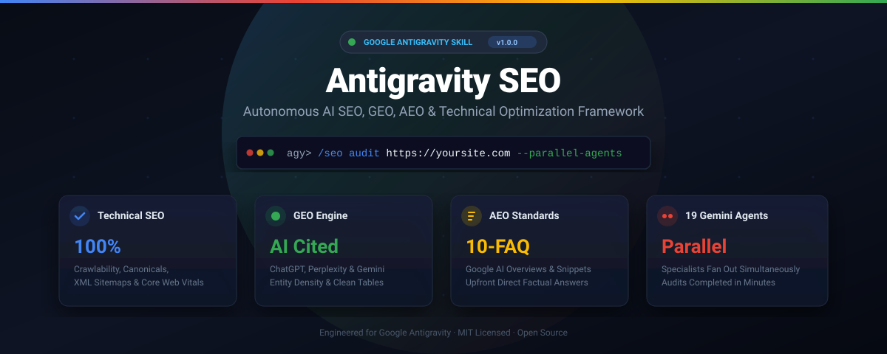
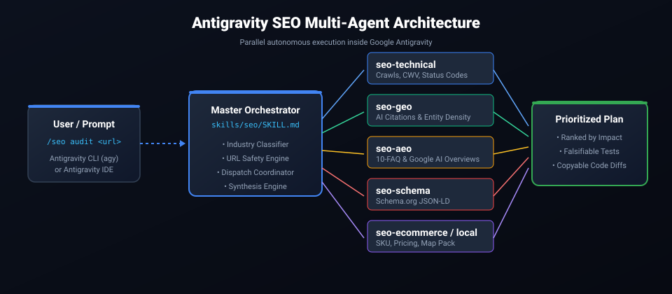

<p align="center">
  
</p>

<h1 align="center">Antigravity SEO</h1>

<p align="center">
  <b>The Autonomous AI SEO, GEO, AEO &amp; Technical Optimization Framework for Google Antigravity.</b><br />
  Rank higher on Google Search, win AI Overviews, and get cited by ChatGPT, Perplexity, Gemini, and Copilot.
</p>

<p align="center">
  <a href="#quick-install">Quick Install</a> ·
  <a href="#why-antigravity-seo">Why Antigravity SEO</a> ·
  <a href="#architecture">Architecture</a> ·
  <a href="#specialist-agents">Specialist Agents</a> ·
  <a href="#commands">Commands</a> ·
  <a href="#acknowledgements">Acknowledgements</a> ·
  <a href="#contributing">Contributing</a>
</p>

<p align="center">
  
  
  
  
  
  
</p>

---

## What is Antigravity SEO?

**Antigravity SEO** is a complete, modular, battle-tested search optimization framework built natively for **Google Antigravity** (and compatible with Cursor and Claude Code agent systems).

Traditional SEO audits give you messy spreadsheets and generic checklists. **Antigravity SEO gives you an autonomous engineering squad.** Give it any website or URL, and up to 17 specialized Gemini agents fan out in parallel to audit, diagnose, generate code diffs, and write validated Schema.org markup.

It is engineered across four critical disciplines of modern search:

1. **Traditional Technical SEO:** Crawlability, indexability, canonical loops, redirect chains, heading hierarchies, XML sitemaps, and Core Web Vitals (LCP, INP, CLS).
2. **Generative Engine Optimization (GEO):** Structured HTML data tables and high entity density (mAh, W, dimensions, protocols) so AI search engines (**ChatGPT Search**, **Perplexity**, **Google Gemini**, **Copilot**) cite your brand and answers.
3. **Answer Engine Optimization (AEO):** Proven 10-FAQ formula with upfront 1–2 sentence direct factual answers engineered to capture **Google AI Overviews** and Featured Snippets.
4. **Commercial & E-Commerce Integrity:** Price completeness checks, SKU standardization, multi-currency support, conversion trust badges, and leaf category assignments.

---

## Architecture & How It Works

<p align="center">
  
</p>

When you invoke `/seo audit <url>`, Antigravity SEO executes a structured four-stage cycle:

1. **Classify & Perceive:** Detects the site archetype (SaaS, E-commerce, Local Business, Publisher, or Agency) and verifies network safety through `scripts/url_safety.py`.
2. **Parallel Agent Dispatch:** Deploys specialist Gemini agents simultaneously across technical, content, schema, speed, and AI citability dimensions.
3. **Analyze & Validate:** Evaluates findings against Schema.org standards, Core Web Vitals thresholds, and anti-AI robotic fluff patterns.
4. **Actionable Delivery:** Synthesizes findings into a prioritized action plan with exact line references, copy-pasteable JSON-LD, and **falsifiable test criteria** so you can verify each fix.

---

## Quick Install

### Method 1: Automatic 1-Click Install

#### For Windows (PowerShell):
```powershell
irm https://raw.githubusercontent.com/IshtiakNihal/Antigravity-SEO/main/install.ps1 | iex
```

#### For macOS / Linux (Bash):
```bash
curl -fsSL https://raw.githubusercontent.com/IshtiakNihal/Antigravity-SEO/main/install.sh | bash
```

### Method 2: Manual Clone
Clone directly into your Antigravity global configuration directory:
```bash
git clone https://github.com/IshtiakNihal/Antigravity-SEO.git ~/.gemini/antigravity/skills/antigravity-seo
```

Once installed, the `antigravity-seo` skill is immediately recognized and available across all your Antigravity workspaces and conversations.

---

## 19 Specialist Gemini Agents

During audits and technical workflows, Antigravity SEO orchestrates 19 autonomous agents:

| Agent | Focus Area | Primary Command |
|---|---|---|
| `seo-technical` | Crawlability, status codes, canonicals, robots.txt | `/seo technical <url>` |
| `seo-geo` | AI Search citability, entity density, structured tables | `/seo geo <url>` |
| `seo-aeo` | 10-FAQ architecture, Google AI Overviews & Snippets | `/seo aeo <topic>` |
| `seo-schema` | Schema.org JSON-LD generation & validation | `/seo schema <url>` |
| `seo-content` | E-E-A-T analysis, information gain, anti-AI tone purifier | `/seo content <url>` |
| `seo-ecommerce` | Catalog integrity, pricing completeness, SKU collisions | `/seo ecommerce <url>` |
| `seo-sitemap` | XML sitemap discovery, partition monitoring, lastmod health | `/seo sitemap <url>` |
| `seo-performance` | Core Web Vitals, script blocking, LCP/INP bottlenecks | `/seo audit <url>` |
| `seo-local` | Google Business Profile, local citations, NAP consistency | `/seo local <url>` |
| `seo-maps` | Local pack visibility, geo-grid ranking, customer reviews | `/seo maps <query>` |
| `seo-cluster` | Semantic keyword clustering and pillar-cluster architecture | `/seo cluster <keyword>` |
| `seo-competitor` | Competitor comparison page blueprints | `/seo competitor-pages` |
| `seo-google` | Search Console, PageSpeed, CrUX & Indexing API queries | `/seo google [cmd]` |
| `seo-backlinks` | Domain backlink profile analysis | `/seo backlinks <url>` |
| `seo-drift` | Content & ranking drift monitoring via SQLite baselines | `/seo drift <cmd>` |
| `seo-sxo` | Search Experience Optimization, user intent & personas | `/seo sxo <url>` |
| `seo-agentic` | AI agent readiness (`llms.txt`, WebMCP, accessibility tree) | `/seo agentic <url>` |
| `seo-programmatic`| Programmatic SEO architecture & scalable URL patterns | `/seo programmatic` |
| `seo-hreflang` | Multi-language international tags & regional canonicals | `/seo hreflang <url>` |

---

## Command Reference

Activate any command inside Google Antigravity:

### 1. Audits & Roadmaps
* `/seo audit <url>`: Full website multi-agent parallel audit.
* `/seo page <url>`: Deep single-page technical and content dissection.
* `/seo plan <business-type>`: Strategic SEO planning (saas, ecommerce, local, publisher, agency).
* `/seo doctor`: Verify environment, tool dependencies, and browser engines.
* `/seo setup`: Refresh Python runtime dependencies and browser binaries.

### 2. Technical & Performance
* `/seo technical <url>`: 9-category technical crawlability and indexability audit.
* `/seo sitemap <url>`: XML sitemap crawler, partition auditor, and status validator.
* `/seo images <url>`: Image optimization, WebP/AVIF format, responsive srcset checks.
* `/seo hreflang <url>`: International SEO, language tag consistency, and regional parity.
* `/seo drift baseline | compare <url>`: Snapshot current site state to track changes over time.

### 3. Content, E-E-A-T & Anti-AI Tone
* `/seo content <url>`: Evaluate topic depth, reading level, and authority signals.
* `/seo content-brief <topic>`: Generate actionable writing briefs with target keywords and outlines.
* `/seo cluster <keyword>`: SERP-based semantic clustering for topic cluster maps.
* `/seo sxo <url>`: Align on-page search experience with real buyer personas.
* `/seo humanize <text>`: Purge robotic AI clichés and enhance factual information density.

### 4. Schema & AI Search (GEO / AEO)
* `/seo schema <url>`: Generate and validate JSON-LD (`Product`, `Article`, `Organization`, `FAQPage`).
* `/seo geo <url>`: Calculate AI Citability Score (0–100) and entity density for LLMs.
* `/seo aeo <topic>`: Construct 10-FAQ clusters with upfront direct factual answers for Google AI Overviews.

### 5. Commerce, Local & Links
* `/seo ecommerce <url>`: E-commerce catalog integrity, pricing, SKU, and schema audit.
* `/seo local <url>`: Local SEO, Google Business Profile, and NAP verification.
* `/seo maps <query>`: Local pack and geo-grid visibility intelligence.
* `/seo backlinks <url>`: Analyze domain backlink profiles and referring domains.

---

## Acknowledgements & Inspiration

Antigravity SEO was inspired by the architectural concepts pioneered by **[AgriciDaniel/claude-seo](https://github.com/AgriciDaniel/claude-seo)** by Daniel Agrici. We express our sincere appreciation for his open-source contributions to the agentic SEO space.

Antigravity SEO has been completely re-engineered from the ground up natively for the **Google Antigravity** ecosystem—powered by Google's Gemini models, Antigravity IDE and CLI runtime, and an independent local-first tool suite.

---

## Contributing

We welcome contributions from the global AI and SEO developer community!
1. Fork the repository.
2. Create your feature branch (`git checkout -b feature/awesome-auditor`).
3. Run the unit test suite (`python -m unittest discover tests -v`).
4. Commit your changes and open a Pull Request.

Please see [`CONTRIBUTING.md`](CONTRIBUTING.md) and [`CODE_OF_CONDUCT.md`](CODE_OF_CONDUCT.md) for details.

---

## License

Distributed under the **MIT License**. See [`LICENSE`](LICENSE) for details.

**Project Founder & Maintainer:** **Ahmed Ishtiak Nihal** ([@IshtiakNihal](https://github.com/IshtiakNihal))
